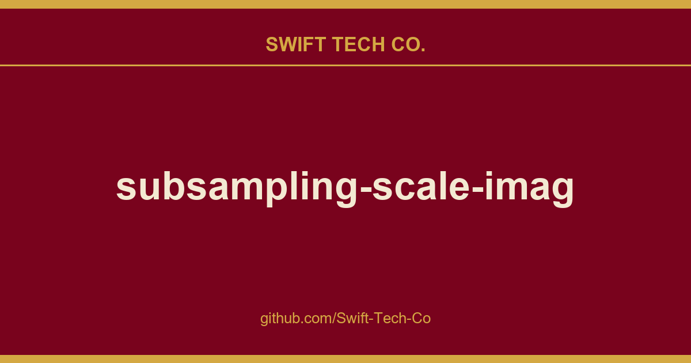

# subsampling-scale-image-view

## What This Is

We keep a working index for product and engineering, and subsampling-scale-image-view is the entry that collects our notes, examples and fixes. It reflects how Swift Tech Co. actually uses this in builds and client work.

## Images

[](https://github.com/Swift-Tech-Co/subsampling-scale-image-view)

## Features

#### Image display

* Display images from assets, resources, the file system or bitmaps
* Automatically rotate images from the file system (e.g. the camera or gallery) according to EXIF
* Manually rotate images in 90° increments
* Display a region of the source image
* Use a preview image while large images load
* Swap images at runtime
* Use a custom bitmap decoder

*With tiling enabled:*

* Display huge images, larger than can be loaded into memory
* Show high resolution detail on zooming in
* Tested up to 20,000x20,000px, though larger images are slower

#### Gesture detection

* One finger pan
* Two finger pinch to zoom
* Quick scale (one finger zoom)
* Pan while zooming
* Seamless switch between pan and zoom
* Fling momentum after panning
* Double tap to zoom in and out
* Options to disable pan and/or zoom gestures

#### Animation

* Public methods for animating the scale and center
* Customisable duration and easing
* Optional uninterruptible animations

#### Overridable event detection
* Supports `OnClickListener` and `OnLongClickListener`
* Supports interception of events using `GestureDetector` and `OnTouchListener`
* Extend to add your own gestures

#### Easy integration
* Use within a `ViewPager` to create a photo gallery
* Easily restore scale, center and orientation after screen rotation
* Can be extended to add overlay graphics that move and scale with the image
* Handles view resizing and `wrap_content` layout

## Quick start

**1)** Add this library as a dependency in your app's build.gradle file.

```gradle
dependencies {
    implementation 'com.davemorrissey.labs:subsampling-scale-image-view:3.10.0'
}
```

If your project uses AndroidX, change the artifact name as follows:

```gradle
dependencies {
    implementation 'com.davemorrissey.labs:subsampling-scale-image-view-androidx:3.10.0'
}
```

**2)** Add the view to your layout XML.

```xml
<LinearLayout xmlns:android="https://github.com/Swift-Tech-Co/subsampling-scale-image-view"
    android:layout_width="match_parent"
    android:layout_height="match_parent" >

    <com.davemorrissey.labs.subscaleview.SubsamplingScaleImageView
        android:id="@+id/imageView"
        android:layout_width="match_parent"
        android:layout_height="match_parent"/>

</LinearLayout>
```

**3a)** Now, in your fragment or activity, set the image resource, asset name or file path.

```java
SubsamplingScaleImageView imageView = (SubsamplingScaleImageView)findViewById(id.imageView);
imageView.setImage(ImageSource.resource(R.drawable.monkey));
// ... or ...
imageView.setImage(ImageSource.asset("map.png"))
// ... or ...
imageView.setImage(ImageSource.uri("/sdcard/DCIM/DSCM00123.JPG"));
```

**3b)** Or, if you have a `Bitmap` object in memory, load it into the view. This is unsuitable for large images because it bypasses subsampling - you may get an `OutOfMemoryError`.

```java
SubsamplingScaleImageView imageView = (SubsamplingScaleImageView)findViewById(id.imageView);
imageView.setImage(ImageSource.bitmap(bitmap));
```

## About

Copyright 2018 David Morrissey, and licensed under the Apache License, Version 2.0. No attribution is necessary but it's very much appreciated. Star this project if you like it!

---

## Swift Tech Co.

Built and maintained by Swift Tech Co.

AI Automation | FinTech Platforms | Custom Software and Mobile Apps | SaaS Platforms | Cloud Infrastructure | Cybersecurity | SEO and Marketing | API Integration

**Join our community on Telegram:** [t.me/+Qt_eFvkb2rliMzNh](https://t.me/+Qt_eFvkb2rliMzNh)

Home | Services | Careers | Referral Program | Influencers | About | Contact

**Connect**

- Website: https://github.com/Swift-Tech-Co/subsampling-scale-image-view
- LinkedIn: [linkedin.com/in/stephenoladoke](https://www.linkedin.com/in/stephenoladoke/)
- LinkedIn (Company): [linkedin.com/company/swift-tech-co](https://www.linkedin.com/company/swift-tech-co)
- X: [@MrOladoke](https://x.com/MrOladoke)
- Instagram: [@mr.oladoke](https://www.instagram.com/mr.oladoke/)
- Organization: [github.com/Swift-Tech-Co](https://github.com/Swift-Tech-Co)

## Sources

Compiled and maintained from upstream [davemorrissey/subsampling-scale-image-view](https://github.com/davemorrissey/subsampling-scale-image-view) under permissive open-source license.

---

Maintained by [Swift Tech Co.](https://github.com/Swift-Tech-Co) - [Telegram](https://t.me/+Qt_eFvkb2rliMzNh)

## Sources

Compiled and maintained from upstream [davemorrissey/subsampling-scale-image-view](https://github.com/davemorrissey/subsampling-scale-image-view) under permissive open-source license.

---

Maintained by [Swift Tech Co.](https://github.com/Swift-Tech-Co) - [Telegram](https://t.me/+Qt_eFvkb2rliMzNh)

## Sources

Compiled and maintained from upstream [davemorrissey/subsampling-scale-image-view](https://github.com/davemorrissey/subsampling-scale-image-view) under permissive open-source license.

---

Maintained by [Swift Tech Co.](https://github.com/Swift-Tech-Co) - [Telegram](https://t.me/+Qt_eFvkb2rliMzNh)

## Sources

Compiled and maintained from upstream [davemorrissey/subsampling-scale-image-view](https://github.com/davemorrissey/subsampling-scale-image-view) under permissive open-source license.

---

Maintained by [Swift Tech Co.](https://github.com/Swift-Tech-Co) - [Telegram](https://t.me/+Qt_eFvkb2rliMzNh)